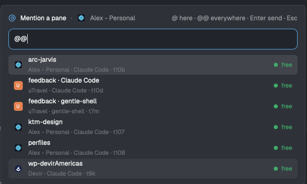
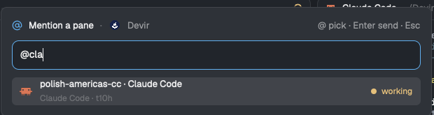
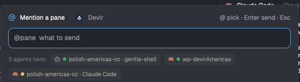

# herdr-mention

Mods for the [Herdr](https://herdr.dev) desktop app.

## Mention

Mention another pane while you talk to your agent. `@` lists the panes of your space, `@@` every agent on every machine. Enter drops `@name (herdr t107)` into the prompt you were writing, so your agent knows who to coordinate with. Write a message after the mention and it goes straight to that pane instead: free panes get it now, working panes when their turn ends, and a pane waiting on you is never typed over.



| `@` filters the panes of the space you are in | Free panes are green; click one to mention it |
| --- | --- |
|  |  |

### How to use it

1. While you write to your agent, press `ctrl-shift-m`.
2. Type `@` and part of a pane's name, or `@@` to search every space and machine. Enter picks it; a click on a chip at the bottom does the same.
3. Press Enter again: the mention lands in your prompt and you keep writing. Or write a message first and Enter sends it to that pane.

Green means the pane is free and gets it now. Yellow means it is working: the message waits for its turn to end. Red means it is waiting on you, so nothing is sent.

Tell your agent:

```
Read ~/.config/herdr-app/AGENTS.md, then add this mod: herdr.dev/mods/Lu7h0r/herdr-mention
```

Or install it by hand:

```sh
./install.sh            # copies mods/mention into ~/.config/herdr-app and binds ctrl-shift-m
```

The brief another agent could rebuild it from is [`mention/RECIPE.md`](mention/RECIPE.md).

### What it needs

- Herdr desktop app with `hc` (herdr-core) on the PATH. Delivery uses `hc send` and, for a working pane, `hc wait`.
- Optional: the Kolczyk spaces mod. When present, the popup shows its icon for the space.

### Disclosure

The mod types into other agents' terminals through `hc send`. It never forces a blocked agent: a pane waiting on you is skipped with a warning.

## License

MIT. `at-sign.svg` is from [Lucide](https://lucide.dev) (ISC).
