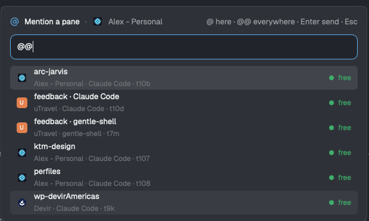

# Mention

One key while you type to an agent: `@` another pane of the space you are in, or `@@` any agent on any machine. Press Enter and the mention lands in the prompt you were writing, with the pane's address, so your agent knows who to talk to. Write a message after the mention instead and it is sent straight to that pane: free panes get it now, working panes when their turn ends, a pane waiting on you is left alone. This is a piece you add to your current layout, not a whole window.



This file is the brief: enough to build Mention from an empty folder. The files next to it are one build of it. If they don't work on your Herdr, or you want it different, build it again from here.

## What you see

- A popup near the top of your window, 560px wide and up to 330px high, offset 64px from the top. Nothing is added to the layout itself.
- A heading, "Mention a pane", with an `@` glyph in the accent color, then the shown space's icon and name. If the Kolczyk spaces mod is installed its icon for the space is used (image, Lucide glyph, emoji or monogram); otherwise a colored monogram like Herdr's own sidebar. On the right: "@ here · @@ everywhere · Enter alone: into your prompt · with text: send".
- One text input, 38px high, with the accent color as its border and the placeholder "@pane  what to send".
- While an `@` is being typed, a list of up to six matching agents under the input. Each row: the program's icon (or the space's icon in `@@` mode), the pane's name in medium weight, a dim second line with the program and terminal address (and the space name in `@@` mode), and on the right a status dot and word: green "free", the theme's working color and "working", or the theme's blocked color, pulsing, and "needs you". The selected row has the theme's selected background.
- When no picker is open, a footer: "N agents here:" followed by one small chip per agent of the shown space, each with the program icon, the status dot and the name. A chip that has already been mentioned is drawn with the selected background.
- Mentioned panes sit inside the input as chips: a rounded token with the program icon and the pane's name, "name · space" when the pane is in another space.
- Your theme's popup background, foreground text, muted and dim secondary text. Text is 12px; the heading is semibold, with 14px padding around the popup and 10px gaps.

## How it behaves

- The opener (`ctrl-shift-m` in the snippet below) opens the popup and focuses the input. Pressing it again while open closes it (`mod.open` toggles).
- Typing `@` followed by text filters the agents of the shown space by pane name or terminal address, free ones first. Typing `@@` filters every agent on every space and machine, matching the space name too. Up/Down or Tab/Shift-Tab move the selection; Enter or a click replaces the `@text` with a chip for that pane. Each pane can be mentioned once.
- A click on a footer chip mentions that pane at the cursor, as if it had been picked from the list, and keeps the keyboard in the input.
- The pane you were in when the popup opened is never offered: you don't mention yourself.
- Enter with no picker open and only chips (no message) drops the mentions into the prompt of the pane you were in, as `@name (herdr t107) `, without pressing Enter. You keep writing your message to your own agent; the address lets it reach the other pane (`hc send t107 ...`). This is the main use.
- Enter with chips and a message sends the message to the mentioned panes instead. The message is the input's text with the chips removed and whitespace collapsed. With no chip the footer says "Type @ to pick a pane" and nothing closes.
- Delivery, per mentioned pane, checked against the agent's live status at that moment:
  - `idle` or `done`: `hc send <address> <text>` right away. A success notification "Sent to <name>" shows the first 120 characters; a failure shows "<name>: not sent" with the command's output.
  - `working`: the message is queued in a detached shell, `hc wait <address>` then `hc send <address> <text>`, so the pane receives it after its current turn and nothing is typed over it. A notification says "Queued for <name>".
  - `blocked`: nothing is sent. A warning notification says "<name> is waiting on you".
- The popup closes once every delivery has been started (sent, queued or refused). While that happens the footer says "Sending to <names>".
- Esc closes the popup at any time. Two panes with the same name in one space (two agents in one tab) are told apart by their program: "name · Claude Code".

## Built from

- **One mod**, `mods/mention/`, with `main.js`, `mod.json` and `at-sign.svg` (Lucide's `at-sign`, ISC, license next to it). The manifest has `place: "none"` and a top popup overlay, so there is no `layouts/` folder or layout change.
- **A `keys.json` snippet** with two bindings, merged into the person's existing keys rather than replacing them:

  ```json
  {
    "global": { "ctrl-shift-m": "mod.open:mention" },
    "terminal": { "ctrl-shift-m": "mod.open:mention" }
  }
  ```

  The global binding opens the popup outside a terminal; the terminal binding opens it while a terminal has focus.
- **A focusable view** with one retained `InputState` from `gpui-base`, created in `init`. The `change` event re-scans the text before the cursor for `/(@@?)([^\s@]*)$/`; the `submit` event picks the selected row when a picker is open and sends otherwise. Mentions are `InlineToken`s: `replace_range_with_token(range, { id: address, text, label })`, drawn through `Input.new(state).token(render)`. `content().tokens` gives the chips back at send time; their ranges are cut out of `content().text`.
- **Data:** `agents()` for the candidates and their live status (filtered by `a.space === focused().space`, or unfiltered for `@@`), `spaces()` for the shown space's name, `shared("kolczyk.spaces")` and `shared("space.colors")` for the space icon, `theme()` for colors. `a.program.icon` with `svg()` when `tint`, else `image()`.
- **Into your prompt:** `focused().terminal` is read in `init` (that pane is the home). The mentions go to the clipboard (`pbpaste` saves the old text, `printf %s "$1" | pbcopy`), the popup closes, `run("pane.focus", {terminal: home})` and `run("terminal.paste", {})` paste them without Enter, and a detached `sleep 1; pbcopy` puts the old text back.
- **Delivery:** `hc(["send", address, text])` for a free pane. For a working pane, `exec("/bin/sh", ["-c", "nohup /bin/sh -c 'hc wait \"$0\" ...; hc send \"$0\" \"$1\" ...' \"$1\" \"$2\" &", "mention", address, text])`, because a mod's `hc()`/`exec()` call is capped at 30 seconds and a turn can take longer. The address and text are passed as positional arguments, never spliced into the shell string. Remote addresses (`machine/t7`) work as `hc` accepts them.
- **Why delivery runs before closing:** a closed mod copy cancels its pending calls, so `send()` awaits every delivery inside `cx.spawn` and only then calls `closeOverlay(props().overlay)`.
- **Customization points** at the top of `main.js`: `MAX_ROWS` (rows in the picker), `WORD` (status words), `MARK` (fallback space colors), the green used for free panes in `statusColor`.

## Watch out

- Dropping into the prompt goes through the clipboard. Text on the clipboard is restored a second later; an image or files on the clipboard are not. `pbcopy`/`pbpaste` make this macOS-only; on Linux use `wl-copy`/`xclip`.

- The mod types into other agents' terminals through `hc send`. Disclose that. It never uses `--force`: a blocked agent (a permission dialog, a question) is not answered for the person.
- A queued message is a detached process. Closing Herdr does not cancel it; it fires when the pane's turn ends. If the pane is closed first, `hc wait` ends and `hc send` fails silently.
- Only terminals that report an agent status (Claude Code, Codex, Pi, Gentle Shell...) are offered. A plain shell never appears, even with `@@`.
- Status is read when Enter is pressed. An agent that starts working between the pick and the send is still handled by its live status, not by the dot that was shown.
- `@@` reaches agents in other spaces and on other machines. Herdr's own guidance keeps agents inside their space; this popup is for the person, who is the one allowed to cross that line.
- Follow the installed `herdr.d.ts` and `gpui-kit.d.ts`. `InputState.new` must not be called in `render`. The input swallows Enter as `submit`, so Enter is handled in that event, not in `on_key_down`.
- Do not depend on Kolczyk: read its shared state when present and fall back to a monogram. Ship your own `at-sign.svg` rather than pointing at another mod's folder.
- Choose a key that is free in the person's `keys.json`; on macOS `ctrl-shift-m` was unused.

## Done when

- `herdr-app check mods/mention` passes with the matching Herdr binary and home.
- The key opens the popup with the input focused; Esc closes it; the key again closes it.
- The pane you were in is not in the list. Picking a pane and pressing Enter with no message leaves `@name (herdr tN) ` in that pane's prompt, nothing submitted, and the clipboard's previous text is back.
- `@` lists only the shown space's agents; `@@` lists every space and machine, with the space icon and name on each row.
- Enter on a row, or a click on a footer chip, inserts a chip; the chip's text is not part of the sent message.
- A free pane receives the exact text and a "Sent to" notification appears; a working pane shows "Queued for" and receives the text after its turn; a blocked pane shows the warning and receives nothing.
- Two agents in one tab are listed under distinct names.
- Normal typing and the person's existing layout and keys still work outside the popup.
